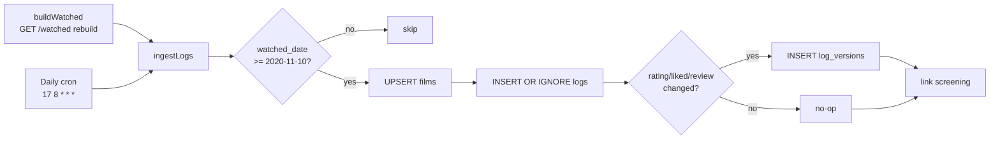

# Film Stats

> **Status: live since 2026-10-23.** Decisions below came from a design
> interview that day and are built as described, with the deviations noted
> inline. The open questions at the end shipped with the defaults listed
> there.

A club-owned, accumulating record of who in the club logged which film, so
the site can say "14 members have logged this" with authority instead of
inferring it from whatever Letterboxd's RSS still serves.

## Why

Today nothing accumulates. `GET /watched` and `data/watched.json` are full
replacements on every refresh, built from each member's RSS feed, which is a
rolling window of at most 50 diary entries (see
[watched.md § Film Shape](watched.md#film-shape)). A film drops out of the
club's view as soon as it scrolls out of everyone's feed. The "This week in
the club" strip can only cluster what is in the current window, so it cannot
answer "how many of us have ever seen this?"

The design driving this is direction **A, "You + the club"**, on the Claude
Design canvas *Watched — Shared Films*: "You + 8 others have logged Digger ·
3 this week", with you first and a per-film page behind it.

## Decisions

| Topic | Decision |
|---|---|
| History | **Club era only.** Count diary entries with `watched_date >= 2020-11-10`, the first event in `data/events.json`. Entries without a diary date are skipped. |
| Backfill | **None.** Ingest starts collecting at launch from each feed's current window (up to 50 entries); nothing older is imported. |
| Data kept per log | Rating, liked, every watch date (rewatches are separate logs), review text, and a link to a club screening. |
| Edits | **Append-only.** A changed rating, like or review adds a new version; nothing is overwritten. Deletions on Letterboxd can't be detected from RSS, so they stay. |
| Departures | **Anonymize, drop text.** Unlink or account deletion replaces the member's identity with an opaque "former member" key and deletes their review text. Counts and ratings stay. A relink starts fresh (below). |
| Scoring | **Latest per member.** One vote per person: the rating from their most recent log whose latest version is rated. A rating cleared on Letterboxd stops counting for that log. Rewatches add dates and logs, not weight. |
| Screening link | **Automatic: attended + same film.** A log links to an event when the member is on that event's attendance list, it is the event's film, and `watched_date` is the event date or the day after. |
| Visibility | **Public counts, members see names.** Anyone sees the counts, average and spread; signed-in members also see who logged it, their ratings and reviews. |
| First surfaces | The per-film page and the `/watched` strip. |
| Strip number | **All-time + this week**: "You + 8 others have logged it · 3 this week". |

## Storage

A new D1 database, `jxnfilm-films`, bound as `FILMS_DB`, with its own
`migrations_dir` (`worker/migrations-films/`) so its schema doesn't share a
numbering sequence with `GIVEAWAYS_DB`. D1 rather than KV because every read
is an aggregate over rows; building those counts in KV would mean
read-modify-write aggregates, which this codebase avoids.

```sql
-- One row per film the club has logged.
CREATE TABLE films (
  slug       TEXT PRIMARY KEY,     -- Letterboxd film slug, e.g. 'digger-2026'
  title      TEXT NOT NULL,
  year       TEXT,
  poster     TEXT,
  first_seen TEXT NOT NULL         -- RFC 3339, when ingest first saw it
);

-- One row per diary entry (a rewatch is its own row).
CREATE TABLE logs (
  id           INTEGER PRIMARY KEY,
  entry_url    TEXT NOT NULL UNIQUE, -- RSS <link>: letterboxd.com/{handle}/film/{slug}/[n/]
  film_slug    TEXT NOT NULL REFERENCES films(slug),
  member_key   TEXT NOT NULL,        -- member id; 'former:<random>' after departure
  handle       TEXT,                 -- NULL after departure
  watched_date TEXT NOT NULL,        -- bare YYYY-MM-DD, never a Date
  rewatch      INTEGER NOT NULL DEFAULT 0,
  event_id     TEXT,                 -- linked club screening, if any
  first_seen   TEXT NOT NULL,
  UNIQUE (member_key, film_slug, watched_date)
);
CREATE INDEX logs_film ON logs(film_slug, watched_date);
CREATE INDEX logs_member ON logs(member_key);

-- Append-only: a new row only when rating/liked/review differ from the latest.
CREATE TABLE log_versions (
  log_id  INTEGER NOT NULL REFERENCES logs(id),
  seen_at TEXT NOT NULL,
  rating  REAL,                      -- 0.5–5, NULL = unrated
  liked   INTEGER NOT NULL DEFAULT 0,
  review  TEXT,                      -- NULL after departure
  PRIMARY KEY (log_id, seen_at)
);
```

As built, the schema also has `films.tmdb_id`, a partial index on unlinked
logs, and a `departures` tombstone table (see [Privacy](#privacy)). The full
schema is `worker/migrations-films/0001_films.sql`.

**Film identity** is the slug parsed from the entry URL: drop the handle
segment and any trailing rewatch counter (`/1/`). Events don't carry a slug
today, so screening matching falls back to normalized `title|year` (the
same key the strip already clusters on). An optional `letterboxd` slug field
on an event makes the match exact. `publicEventProjection` passes it through
to `events:all`, but no admin or host form sets it yet; it has to be written
to the event row directly.

**Edited diary dates.** An entry whose date is changed on Letterboxd keeps its
URL. Ingest moves the stored log to the new date (clearing `event_id` so it
re-links) before inserting, so later rating or review changes still version
it.

**Why two uniqueness rules.** `entry_url` contains the handle, so a member
who renames their Letterboxd account would re-ingest every entry under new
URLs. `UNIQUE (member_key, film_slug, watched_date)` catches that, at the
cost of merging two same-day logs of one film into one. That is rare enough
to accept.

## Ingest



- **Where:** `buildWatched()` already downloads every linked member's whole
  feed (50 diary entries). After a successful parse it hands the full-depth
  films to `ingestLogs(env, member, films)` via `ctx.waitUntil`, so ingest
  costs no extra Letterboxd requests. The daily cron also runs a rebuild, so
  a quiet day with no `/watched` traffic still gets captured. A member would
  have to log more than 50 films in a day to slip through.
- **Who:** only current members with a verified handle (the same
  `readMembersAll` list `buildWatched` uses), keyed by member **id**, not
  handle.
- **Reviews:** `parseLetterboxdRss` doesn't extract review text today.
  `scripts/refresh_letterboxd.py` does (`extract_review`, spoiler
  filtering); port that logic to the Worker parser.
- **Screening link:** set `event_id` when the member's id is in that event's
  attendance, the film matches, and `watched_date` is the event date or the
  next day. It runs right after every ingest that inserted or re-dated a log,
  from the earliest such date, so the launch backfill and a member who links
  Letterboxd late get their older screenings linked. Marking attendance
  (`POST /events/:id/attend`) links that member's log of that event at once.
  The daily cron also re-checks unlinked logs from the last 14 days, as a
  catch-up for attendance recorded other ways (RSVPs, admin edits).
- **Departed members** are skipped: ingest ignores any member id in the
  `departures` table, so a rebuild that read a stale `members:all` cannot
  re-insert their feed.

## Reads

| Endpoint | Access | Returns |
|---|---|---|
| `GET /films/:slug` | public | `{ film: { slug, title, year, poster }, members, logs, thisWeek, avg, liked, histogram, screenings }` |
| `GET /films/:slug` | signed in | the above plus `watchers: [{ name, handle, rating, liked, dates, review }]` and `you` |
| `GET /films/stats?slugs=a,b,…` | public, ≤ 40 slugs | per slug: `{ members, logs, thisWeek }`; signed in adds `you: true/false` |

Derived values, all computed in SQL over `logs` and each log's latest
version:

- `members`: distinct `member_key` (former members included).
- `logs`: row count, rewatches included.
- `thisWeek`: distinct members with `watched_date >=` the 7-day Central
  cutoff (`centralDayCutoff`, same as the strip).
- `avg`, `liked`, `histogram`: one vote per member, from their most recent
  log whose latest version is rated.
- `screenings`: event ids with at least one linked log.

Public responses get a short edge `Cache-Control` like `/watched`. Responses
with names are `private, no-store`.

## Surfaces

**`/watched` strip.** The weekly clustering in `buildWatchedPage` stays as is.
After clustering, the view fetches `GET /films/stats` for the strip's slugs
and renders direction A:

- Signed in, you logged it: "**You** + 8 others have logged it · 3 this week",
  you first, a "You too" stamp. The stamp needs another member among this
  week's watchers: a card where you are the only one is your own diary entry,
  not a match. On the film page it needs at least one other logger.
- Signed in, you didn't: "9 members have logged it · 3 this week".
- Signed out: the same count line. This week's names still show, because the
  weekly strip already shows them publicly from RSS. All-time names stay
  members-only.
- The count line only says what the card doesn't already. A film just one
  member logged has no count line, because the one name under it says it.
  "· K this week" is dropped when K equals the all-time count ("You + 6
  others have logged it", not "· 7 this week"). The film page follows the
  second rule but keeps "Only you have logged it", since it lists no names
  beside the count. "· K this week" never wraps mid-phrase (`.ws-week`).
- Names beyond the first six collapse to a "+N more" button. Separators are
  markup inside each name's no-wrap span, never CSS `::before`, so a wrapped
  line can't start with a comma.
- If `FILMS_DB` is unreachable, the strip falls back to today's weekly-only
  byline.

**Per-film page, `/film?slug=<slug>`.** *Deviation from the planned
`/film/<slug>`:* the router is `/:type` and nuestate drops a second path
segment from the URL it writes, so the slug rides in a registered query key
(`slug` in `QUERY_KEYS`, `index.html`). A cold hit on `/film/<slug>` is
rewritten to the query form. "Sign in to see who" returns the member to the
same film page after OTP (`jxnfcStashNext` keeps `/film?slug=` only). Poster, title, year; the count line;
average, hearts and the rating spread (direction C's dot strip can be reused
here); club screenings of this film; and, for signed-in members, the list of
watchers with each person's latest rating, dates and review. Strip cards
link here.

## Privacy

This is new retention and needs a policy update before launch (bump "Last
updated" in `worker/src/privacy.html`):

- **What we collect:** a club-era history of your Letterboxd diary entries
  (film, date, rating, like, review), copied from your public RSS while your
  account is linked.
- **How long:** until you unlink Letterboxd or delete your account. Then
  your name, handle and review text are deleted and your ratings stay as an
  unattributed "former member".
- **Who sees it:** counts are public; names, ratings and reviews are visible
  to signed-in members only on film pages.

Cascades: `unlinkCascade()` and `handleMemberDelete()` both call
`anonymizeFilmLogs(env.FILMS_DB, member.id)`. It assigns one random
`former:` key per departing member, so "one vote per person" still holds,
sets `handle` to NULL and `review` to NULL, rewrites `entry_url` (it embeds
the handle), and in the same batch writes a `departures` tombstone that
blocks any later or in-flight ingest of that id. It runs before any KV
mutation and is unguarded in both, matching `purgeRsvps` and
`purgeVoiceClips`: a failure blocks the unlink or deletion rather than
claiming success.

- **Unlink** keeps the tombstone's id → former-key mapping (private, never
  served). Setting a handle again (`POST /member/update`) calls
  `relinkFilmLogs`, which deletes the former rows and the tombstone, so the
  log starts fresh and the member is not counted twice. Entries older than
  the feed's window are not re-added.
- **Account deletion** passes `forget: true`: the tombstone stays (the id must
  never be re-ingested) but its `former_key` is NULLed, so the anonymized rows
  are not linkable to the id.
- **Handle switch without unlinking** (`POST /member/update` with a different
  handle) calls `purgeFilmLogs`: the old handle's logs are deleted outright,
  since it may have been a typo or someone else's account.

`worker/src/privacy.html` (updated 2026-10-23) describes all three.

## Open questions (shipped defaults)

Each is still open for a later decision; this is what the code does today.

1. **Backfill: none.** Candidates for later: replay the committed versions of
   `data/watched.json` (since 2026-04-14), a member CSV import of their
   Letterboxd diary export on `/edit`, or an admin-run import. Only a member
   or admin import reaches back to 2020.
2. **Relinking: fresh.** A relink deletes the member's former-member rows
   (via the unlink tombstone's mapping) and re-ingests whatever the feed still
   carries under the live id. No double counting, at the cost of losing
   entries older than the feed window. Re-claiming the old rows instead was
   rejected: it would re-attribute history the member chose to detach.
3. **Departed members' versions: all kept.** Anonymization nulls review text
   on every version and keeps every rating version.
4. **Admin Stats tab: unchanged.** It still reads the full-depth `/watched`
   cache.
5. **Film identity: TMDB id found.** Letterboxd RSS carries
   `<tmdb:movieId>`; it is stored as `films.tmdb_id` (indexed) as a secondary
   key. Nothing reads it yet.

## Deploying

`jxnfilm-films` (prod) and `jxnfilm-films-staging` were created on
2026-10-23; their ids are in `worker/wrangler.toml`. CI deploys the Worker
but never runs D1 migrations, so a new file in `worker/migrations-films/`
must be applied by hand **before** the push that needs it:

```
cd worker
npx wrangler d1 migrations apply jxnfilm-films --remote
npx wrangler d1 migrations apply jxnfilm-films-staging --env staging --remote
```

Local e2e runs apply the FILMS_DB migrations themselves
(`playwright.config.ts` webServer).

## Key files

| File | Role |
|---|---|
| `worker/migrations-films/0001_films.sql` | Schema: `films`, `logs`, `log_versions`, `departures` |
| `worker/src/films.js` | `ingestMany`/`ingestLogs`, `linkScreenings`, `anonymizeFilmLogs`, `relinkFilmLogs`, `purgeFilmLogs`, `filmStats`, `filmDetail` |
| `worker/src/index.js` | Ingest + link in `buildWatched`; daily cron `refreshFilmLogs`; `/films/*` routes; unlink/delete/handle-change cascades; link on attend |
| `worker/wrangler.toml` | `FILMS_DB` binding (prod + staging) |
| `model/index.ts` | `getFilmStats`, `getFilm`, strip byline and film-page shaping |
| `ui/views.html`, `css/watched.css`, `css/film.css` | Direction A strip; `/film?slug=` view |
| `index.html` | `slug` query key; `/film?slug=` sign-in return |
| `worker/src/privacy.html` | Retention + visibility changes |
| `playwright.config.ts` | Applies FILMS_DB migrations to the local e2e database |
| `tests/worker/films.test.js`, `tests/model/film-stats.test.ts` | Ingest, versioning, linking, departures/relink, endpoints; client fetch + shaping |
